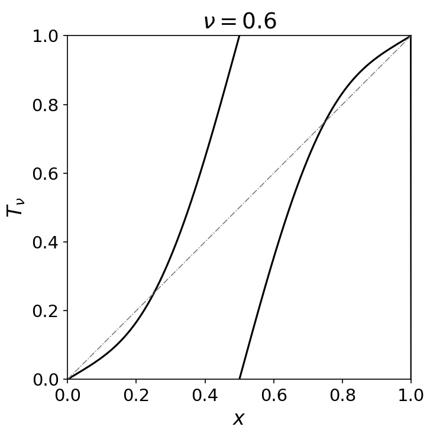

# Intermittency and Infinite Ergodic Measures in the Two-Point Dynamics of Random Circle Endomorphisms

# 1 Introduction

This essay is based on this paper:

- [V. P. H. Goverse, A. J. Homburg, and J. S. W. Lamb. Intermittent two-point dynamics at the transition to chaos for random circle endomorphisms. arXiv:2503.08244, 2025.](https://arxiv.org/abs/2503.08244)

The definitions used are mostly based on these lecture notes:

- [Bernat Bassols Cornudella Lecture 7: Infinite ergodic theory and intermittency in a random logistic map (2026)](https://rdset2026.blogspot.com/2026/03/lecture-7-infinite-ergodic-theory-and.html)
- [Martin Rasmussen, Random Dynamical Systems (2023)](https://www.dropbox.com/scl/fi/6c1ku1i6g28cyfouse5br/RDS_Lecture_Notes_2023.pdf?rlkey=bx5xlkin6j30b4edga227kxz6&e=1&dl=0)

## 1.1 Motivation

In dynamical systems, the transition from predictable motion to chaos is a central theme of bifurcation theory. While deterministic routes to chaos are well studied, the transitions in random dynamical systems are less understood. Historically, the research into this transition began in the late 1980s on stochastic differential equations by Baxendale and Stroock [1,2] and numerical simulations of discrete-time random maps in the 1990s by Pikovsky [3] and Yu, Ott and Chen [4]. 

The paper by Goverse investigates whether intermittency and the existence of an infinite ergodic stationary measure are generic features of the transition to chaos. It focuses on circle endomorphisms of degree two with additive noise where the Lyapunov exponent $λ$ vanishes. This paper analyses the stationary measures of the two-point motion from both a topological and a measure-theoretic perspective. The authors develop the Koopman operator tools to derive quantitative estimates on escape times near the diagonal. 

The objective of this essay is to examine the two main result of this paper on intermittency $λ=0$:

> 
> 
> 
> **Theorem 1.1(2) (Topological random dynamics)** Let $T_{\omega}$ be a random dynamical system satisfying hypotheses (H1) to (H5), $\lambda$ be its Lyapunov exponent, and let $T_{\omega}^{(2)}$ be the corresponding two-point random dynamical system. Then:
> 
> **Intermittency:** if $\lambda = 0$, for all $(x, y) \in \mathbb{T}^2 \setminus \Delta$,
> 
> $$
> \begin{aligned}\lim_{n\to\infty} \frac{1}{n} \sum_{i=0}^{n-1} d(T_{\omega}^i(x), T_{\omega}^i(y)) = 0 \text{ and } \limsup_{n\to\infty} d(T_{\omega}^n(x), T_{\omega}^n(y)) > 0, \quad \mathbb{P} - \text{a.s.}\end{aligned}
> $$
> 

> 
> 
> 
> **Theorem 1.2(2) (Stationary measures).** Let $T_{\omega}$ be as in Theorem 1.1, and let $\mu$ denote its unique stationary (probability) measure. Then,
> 
> If $\lambda = 0$, $\mu$ on $\Delta$ is the unique stationary probability measure for $T_{\omega}^{(2)}$. In addition, $T_{\omega}^{(2)}$ admits an infinite stationary (Radon) measure $\mu^{(2)}$ on $\mathbb{T}^2 \setminus \Delta$, which has full support. Moreover, for each such measure there exist $\alpha, \beta \in (0, \infty)$ such that
> 
> $$
> \begin{aligned}\alpha \le \liminf_{\varepsilon \to 0} \frac{\mu^{(2)}(\mathbb{T}^2 \setminus \Delta_{\varepsilon})}{-\ln(\varepsilon)} \le \limsup_{\varepsilon \to 0} \frac{\mu^{(2)}(\mathbb{T}^2 \setminus \Delta_{\varepsilon})}{-\ln(\varepsilon)} \le \beta\end{aligned}
> $$
> 

These theorems will be discussed in section 1.3 and section 1.4. 

## 1.2 Random Dynamical System Setup

### 1.2.1 Base Dynamics: Random Circle Endomorphisms

The random dynamical system is defined by a class of smooth monotone circle endomorphisms $T : \mathbb{T} \to \mathbb{T}$ of degree $k > 1$, where $\mathbb{T} = \mathbb{R}/\mathbb{Z}$. Unlike circle homeomorphisms of degree $k=1$, which are used to study non-positive Lyapunov exponents and synchronisation, endomorphisms wrap the circle multiple times, which can create chaotic dynamics.

We focuses on a parameter family of maps with additive noise. For each $\omega \in\Omega_{\vartheta}$ , the circle endomorphism $T_\omega(x)$ is obtained by composing  $T$ with a translation:

$$
T_\omega(x) := T(x + \omega \pmod 1)
$$

We consider a random process $(\omega_i)_{i \in \mathbb{N}}$, where the $\omega_i$ are drawn i.i.d from a uniform distribution on

$$
\Omega_{\vartheta} := [-\vartheta, \vartheta]
$$

For an initial point $x_0 \in \mathbb{T}$, this yields a random dynamical system:

$$
x_{n+1} = T_{\omega_n}(x_n)
$$

### 1.2.2 Skew products system

To analyse the long-term statistical properties of the system, we define the noise space as the one-sided infinite sequence space:

$$
\Sigma_{\vartheta} := \Omega_{\vartheta}^{\mathbb{N}}
$$

where a point $\omega = (\omega_i)_{i \in \mathbb{N}} \in \Sigma_{\vartheta}$ represents a single realisation of the noise.

The space $\Sigma_{\vartheta}$ is endowed with the product topology generated by cylinder sets. For Borel sets $A_i \subset\Omega_{\vartheta}$, cylinders are:

$$
[A_0, A_1 \dots, A_k] = \{ \omega \in \Sigma_{\vartheta} : \omega_i \in A_i, 0 \le i \le k \}
$$

Let $\nu=\text{Leb}/(2\vartheta)$ denote the normalized Lebesgue measure on noise space $\Omega_{\vartheta}$. Since the random variables $w_i$ are i.i.d, we can define the product (Bernoulli) measure $\mathbb{P}$ on cylinder sets as:

$$
\mathbb{P}([A_0, A_1 \dots, A_k]) := \prod_{i=0}^{k} \nu(A_i)
$$

By Carathéodory’s extension theorem, $\mathbb{P}$ extends uniquely to the product $\sigma$-algebra $\mathcal{F}$  on $\Sigma_{\vartheta}$. The noise evolved by the left shift operator $\sigma : \Sigma_{\vartheta} \to \Sigma_{\vartheta}$:

$$
\sigma(\omega_0, \omega_1, \omega_2, \dots) := (\omega_1, \omega_2, \dots)
$$

The shift map $\sigma$ is measurable with respect to $\mathcal{F}$ as the preimage of any cylinder set is simply another cylinder set with the first coordinate unconstrained: 

$$
\sigma^{-1}([A_0, \dots, A_k]) = [\Omega_{\vartheta}, A_0, \dots, A_k]
$$

The measure $\mathbb{P}$ satisfies two fundamental properties:

1. **Invariance:** $\mathbb{P}$ is $\sigma$-invariant, meaning $\mathbb{P}(\sigma^{-1} B) = \mathbb{P}(B)$ for any $B \in \mathcal{F}$. This can be verified on a cylinder set:
    
    $$
    \mathbb{P}(\sigma^{-1}[A_0, \dots, A_k]) = \nu(\Omega_{\vartheta}) \prod_{i=0}^{k} \nu(A_i) = 1 \cdot \prod_{i=0}^{k} \nu(A_i) = \mathbb{P}([A_0, \dots, A_k])
    $$
    
2. **Ergodicity:** An invariant measure $\mathbb{P}$ is ergodic if for any $\sigma$-invariant measureable set with $\sigma^{-1} B = B$, has either measure zero or full measure $\mathbb{P}(B) \in \{0, 1\}$ . Ergodicity ensures that  time average of an orbit equals to space averages, which is important for applying Birkhoff’s Ergodic Theorem later. 

This setup allows the random process to be treated as a deterministic skew product map $\Theta: \Sigma_{\vartheta} \times \mathbb{T} \to \Sigma_{\vartheta} \times \mathbb{T}$:

$$
\Theta(\omega, x) := (\sigma\omega, T_{\omega_0}(x))
$$

The random dynamical system can be viewed as a cocycle, where the $n$th iterate $T_{\omega}^n(x)$ is the composition of $n$ different random maps:

$$
T_{\omega}^n(x) := T_{\omega_{n-1}} \circ \dots \circ T_{\omega_0}(x)
$$

A measure $\mu$ on $\mathbb{T}$ is called stationary if the product measure $\mathbb{P} \times \mu$ is $\Theta$-invariant:

$$
\mu(A) = \int_{\Sigma_{\vartheta}} \mu\left(T_{\omega}^{-1}(A)\right) d\mathbb{P}(\omega) 
$$

for any (Borel) measurable set $A \subset \mathbb{T}$.  

### 1.2.3 Two-Point Motion and the Diagonal

While one-point motion provides the stationary distribution of the system, it is insufficient to detect transition to chaos. Thus, we focus on the two-point motion on $\mathbb{T}^2$, where the points $(x,y)$ evolve under the same noise realisation $\omega \in \Sigma_{\vartheta}$:

$$
(x_{n+1}, y_{n+1}) = T_{\omega_n}^{(2)}(x_n, y_n) = (T_{\omega_n}(x_n), T_{\omega_n}(y_n))
$$

The two-point skew product map $\Theta^{(2)} : \Sigma_{\vartheta} \times \mathbb{T}^2 \to \Sigma_{\vartheta} \times \mathbb{T}^2$ is denoted by

$$
\Theta^{(2)}(\omega, x, y) = (\sigma\omega, T_{\omega}^{(2)}(x, y))
$$

A measure $\mu^{(2)}$ on $\mathbb{T}^2$ is a stationary measure of the random dynamical system $T_{\omega}^{(2)}$ on $\mathbb{T}^2$ if

$$
\int_{\Sigma_{\vartheta}} \mu^{(2)}\left((T_{\omega}^{(2)})^{-1}(A)\right) d\mathbb{P}(\omega) = \mu^{(2)}(A)
$$

for any (Borel) measurable set $A \subset \mathbb{T}^2$. 

The key object in this analysis is the diagonal, which represents synchronisation where $x=y$:

$$
\Delta := \{(x, x) \in \mathbb{T}^2 : x \in \mathbb{T}\}
$$

While the stationary measure $\mu$ of the one-point motion is naturally supported on $\Delta$, the transition to chaos is obtained by studying stationary measures $\mu^{(2)}$ supported on $\mathbb{T}^2 \setminus \Delta$ and their behavior within the $\varepsilon$-neighborhood of the diagonal:

$$
\Delta_{\varepsilon} := \{(x, y) \in \mathbb{T}^2 : d(x, y) < \varepsilon\}
$$

## 1.3 Lyapunov exponent and Intermittency

The stability of a random dynamical system is determined by its sensitivity to initial conditions. If we consider an infinitesimal perturbation $\delta_0$ at $x_0$, its evolution after $n$ steps is given by the first-order Taylor expansion: 

$$
\delta_n \approx DT_\omega^n(x_0) \delta_0
$$

The Lyapunov exponent $\lambda$ represents the rate such that the separation grows or shrinks exponentially as $|\delta_n| \approx |\delta_0| e^{\lambda n}$. By taking the logarithm and rearranging, we get:

$$
\lambda(x_0, \omega)  \approx \frac{1}{n} \ln \left| \frac{\delta_n}{\delta_0} \right| \approx \frac{1}{n} \ln |DT_\omega^n(x_0)|
$$

By the chain rule, the derivative of the $n$-step cocyle is a product of individual derivatives evaluated along the random orbit $x_i = T_\omega^i(x_0)$:

$$
DT^n_\omega(x_0) = \prod_{i=0}^{n-1} DT_{\omega_i}(x_i)
$$

Taking the logarithm converts this product into a summation of growth rates:

$$
\ln |DT_\omega^n(x_0)| = \ln \left| \prod_{i=0}^{n-1} DT_{\omega_i}(x_i) \right| = \sum_{i=0}^{n-1} \ln |DT_{\omega_i}(x_i)|
$$

We are interested in the exponential growth behaviour of $|DT_\omega^n(x_0)|$ as $n \to \infty$. This is described by Lyapunov exponent, which is defined as the limit of the time average: 

$$
\lambda(x_0, \omega) = \lim_{n \to \infty} \frac{1}{n} \ln |DT_\omega^n(x_0)| = \lim_{n \to \infty} \frac{1}{n} \sum_{i=0}^{n-1} \ln |DT_{\omega_i}(x_i)|
$$

The connection between the asymptotic behavior of individual trajectories and the statistical properties of the system is provided by Birkhoff’s Ergodic Theorem. Consider the probability space $(X, \mathcal{F}, m)$ where $X = \Sigma_\vartheta \times \mathbb{T}, m = \mathbb{P} \times \mu$, and the dynamics are governed by the skew product $\Theta(\omega, x) = (\sigma\omega, T_{\omega_0}(x))$. 

Because the product measure $\mathbb{P}\times \mu$ is an ergodic invariant measure with respect to $\Theta$, the ergodic version of Birkhoff’s Ergodic Theorem states that for any integrable observable $g: X \to \mathbb{R}$, the time average converges to the space average for $m$-almost surely:

$$
\lim_{n \to \infty} \frac{1}{n} \sum_{i=0}^{n-1} g(\Theta^i(\omega,x)) = \mathbb{E}[g], \quad m\text{-a.s.} 
$$

In our setting, the observable is the local derivative of the map $g(\omega, x) = \ln |DT_{\omega_0}(x)|$.  Applying Birkhoff’s Ergodic Theorem to the Lyapunov exponent, it becomes a global space average:

$$
\lambda = \lim_{n \to \infty} \frac{1}{n} \ln |DT_\omega^n(x)| = \int_{\Sigma_\vartheta \times \mathbb{T}} \ln |DT_{\omega_0}(x)| \, d(\mathbb{P} \times \mu)(\omega, x)
$$

Since $g$ depends only on the first noise coordinate $\omega_0$, the integral over the sequence space $\Sigma_\vartheta$ simplifies to an integral over the noise space $\Omega_\vartheta$:

$$
\lambda = \frac{1}{2\vartheta} \int_{\mathbb{T}} \int_{[-\vartheta, \vartheta]} \ln |DT_{\omega}(x)| \, d\text{Leb}(\omega) \, d\mu(x)
$$

Under Hypotheses H1-H2 (from chapter 2), the system has a unique stationary measure $\mu$ with smooth and everywhere positive density. Thus, $\lambda$  is a constant that is indepentdent of the initial state $x_0$ or the noise realisation $\omega$ for the one-point motion. 

The behavior of the two-point motion is classified by the sign of $\lambda$ :

- $\lambda <0$: Synchronization
- $\lambda =0$: Intermittency
- $\lambda >0$: Chaos

This essay focus on intermittency. As stated in Theorem 1.1(2), the two-point motion at $\lambda =0$ satisfies two conditions. First, the time average of distance vanishes:

$$
\lim_{n\to\infty} \frac{1}{n} \sum_{i=0}^{n-1} d(T_{\omega}^i(x), T_{\omega}^i(y)) = 0 \quad \mathbb{P}\text{-a.s.}
$$

This implies that the trajectories are close together most of the time. In terms frequency, the proportion of time the orbit $(x_n, y_n)$ spends inside the $\varepsilon$-neighborhood of the diagonal $\Delta_{\varepsilon}$ converges to one: 

$$
\lim_{N \to \infty} \frac{1}{N} \big| \{0 \le n < N : (x_n, y_n) \in \Delta_{\varepsilon} \} \big| = 1
$$

However, the second condition shows that the system never permanently synchronises:

$$
\limsup_{n\to\infty} d(T_{\omega}^n(x), T_{\omega}^n(y)) > 0, \quad \mathbb{P}\text{-a.s.}
$$

Despite the density of visits to $\Delta_{\varepsilon}$ approaching 1, there exist infinitely many $n$ such that the two-point orbit escapes the $\varepsilon$-neighborhood of diagonal. The system keep experiencing separations before being pulled back toward the diagonal again, resulting intermittency. 

While this paper focus on one-dimensional circle endomorphisms, a natural question is how these results extend to higher dimensions. In one dimension, the stability of the two-point motion is determined by a single scalar Lyapunov exponent. In $d$ dimensions, the derivative $DT_\omega^n(x)$ becomes a $d \times d$ Jacobian matrix. By the Multiplicative Ergodic Theorem, there exists a spectrum of Lyapunov exponents:

$$
\lambda_1 \ge \lambda_2 \ge \dots \ge \lambda_p
$$

and nested sequence of subspaces:

$$
\mathbb{R}^d = V_1(\omega) \supset V_2(\omega) \dots \supset V_p(\omega) \supset \{0\} 
$$

The growth rate of an initial separation vector $v$ depends on which subspace it occupies. If $v \in V_i(\omega) \setminus V_{i+1}(\omega)$, then:

$$
 \lim_{n \to \infty} \frac{1}{n} \ln \|DT_\omega^n(x) v\| = \lambda_i, \quad \mathbb{P}\text{-a.s.} 
$$

In higher dimensions, the transition to chaos occurs when the top Lyapunov exponent crosses zero $\lambda_1=0$, while the remaining exponents may remain negative, e.g. $\lambda_2<0$. In 1D, Theorem 1.2(2) guarantees that the infinite measure $\mu^{(2)}$ has full support off the diagonal.  However, consider a 2D system, the strong contraction along the stable $V_2$ direction $(\lambda_2<0)$ would likely force the measure to collapse onto a lower-dimensional subspace and lose its full support over the 2D domain. Hence, extending these 1D results to higher dimensions remains a challenging research area. 

## 1.4 Infinite Ergodic Stationary Measure

### 1.4.1 Limitations of Probability measure

Let’s try to apply Birkhoff’s Ergodic Theorem to two-point motion at intermittency $\lambda= 0$. Let the observables be the distance function $g(x,y) = d(x,y)$. Theorem 1.1(2) requires that for $(x,y) \in \mathbb{T}^2 \setminus \Delta$, the time average of this distance to be zero:

$$
\lim_{n\to\infty} \frac{1}{n} \sum_{i=0}^{n-1} d(T_{\omega}^i(x), T_{\omega}^i(y)) = 0 \quad \mathbb{P}\text{-a.s.}
$$

If a stationary probability measure $\mu^{(2)}$ exists with total mass $\mu^{(2)}(\mathbb{T}^2) =1$, Birkhoff’s Ergodic Theorem requires the space average to also be zero:

$$
\int_{\mathbb{T}^2} d(x,y) \, d\mu^{(2)}(x,y) = \lim_{n \to \infty} \frac{1}{n} \sum_{i=0}^{n-1} d(x,y) = 0
$$

Since $d \ge 0$, an integral of zero implies that the integrand must also zero almost everywhere. This forces any stationary probability measure to be supported entirely on the diagonal: 

$$
\text{supp}(\mu^{(2)}) \subseteq \Delta 
$$

This finite probability measure can only describe synchronisation and ignore the off-diagonal region $\mathbb{T}^2 \setminus \Delta$. However, we know from the second part of Theorem 1.1(2) that trajectories do not stay synchronised forever, the positive limit superior confirms the separations occur infinitely often. 

This contradiction shows that finite probability measures cannot represent a system that is both chaos and synchronised at the same time. To resolve this, we need to move to infinite ergodic theory. 

### 1.4.2 Infinite Measure (Radon) and Asymptotics at the diagonal

The main result of Theorem 1.2(2) is the existence of an infinite stationary Radon measure $\mu^{(2)}$ on the open domain $\mathbb{T}^2 \setminus \Delta$. A Radon measure is locally finite. This implies that for any compact subset $\mathcal{K} \subset \mathbb{T}^2  \setminus \Delta$ disjoint from the diagonal, the measures is finite: $\mu^{(2)}(\mathcal{K}) < \infty$. However, the total mass of the open domain diverges: $\mu^{(2)}(\mathbb{T}^2 \setminus \Delta) = \infty$. 

Theorem 1.2(2) derives the asymptotics of this measure as it approaches the diagonal. For $\alpha, \beta \in (0, \infty)$, the mass of the off-diagonal region grows logarithmically as $\varepsilon \to 0$: 

$$
\alpha \le \liminf_{\varepsilon \to 0} \frac{\mu^{(2)}(\mathbb{T}^2 \setminus \Delta_{\varepsilon})}{-\ln(\varepsilon)} \le \limsup_{\varepsilon \to 0} \frac{\mu^{(2)}(\mathbb{T}^2 \setminus \Delta_{\varepsilon})}{-\ln(\varepsilon)} \le \beta
$$

The space $\mathbb{T}^2$ is a compact torus. For any $\varepsilon > 0$, the $\varepsilon$-neighborhood $\Delta_{\varepsilon}$ is an open set. Its complement, $\mathbb{T}^2 \setminus \Delta_\varepsilon$, is a closed and therefore compact subset of the open domain $\mathbb{T}^2 \setminus \Delta$. The upper bound $\beta$ ensure that the measure is Radon (locally finite), so that $\mu^{(2)}(\mathbb{T}^2 \setminus \Delta_\varepsilon)$ remains finite for any fixed $\varepsilon > 0$. 

However, as $\varepsilon \to 0$, the term $-\ln (\varepsilon)$ divergges. Because the ratio bounded between two positive constants, the numerator $\mu^{(2)}(\mathbb{T}^2 \setminus \Delta_\varepsilon)$  must also diverge at the same rate. This implies the total mass of the stationary Radon measure is infinite:

$$
\mu^{(2)}(\mathbb{T}^2 \setminus \Delta) = \lim_{\varepsilon \to 0} \mu^{(2)}(\mathbb{T}^2 \setminus \Delta_{\varepsilon}) = \infty 
$$

This slow logarithmic divergence indicates intermittency. It quantifies how the system density accumulates near the synchronised state while maintaining rare separations into the chaotic region. 

### 1.4.3 Ergodicity and Full Support of the Infinite Measure

To analyse the dynamics at off-diagonal, we use Infinite Ergodic Theory (IET). Let the measurable space be $(X, \mathcal{A})$, where  $X = \mathbb{T}^2 \setminus \Delta$ and $\mathcal{A}$ is the associated Borel $\sigma$-algebra. In IET, we are interested in measures $\mu^{(2)} : \mathcal{A} \to [0,\infty]$ that give infinite weight to the full set such that $\mu^{(2)}(X)  = \infty$.

We consider measures that are $\sigma$-finite. This requires that the space $X$ can be covered by a countable union of measurable subsets $X_n$ of finite measure:

$$
 X = \bigcup_{n \ge 0} X_n, \quad \text{with } X_n \in \mathcal{A}^+ := \{A \in \mathcal{A} : 0 < \mu^{(2)}(A) < \infty\} 
$$

In our setting, the Radon property of $\mu^{(2)}$ guarantees $\sigma$-finite. We can construct this countable cover by using $X_n := \mathbb{T}^2 \setminus \Delta_{1/n}$, each $X_n$ is disjoint from the diagonal. Radon measure ensures that $\mu^{(2)}(X_n) < \infty$, satisfying the $\sigma$-finite condition. 

Theorem 1.2(2) also proves that the infinite stationary measure $\mu^{(2)}$ has full support on the open domain $\mathbb{T}^2 \setminus \Delta$. A measure has full support if every non-empty open set $U \subseteq \mathbb{T}^2 \setminus \Delta$ has strictly positive measure: $\mu^{(2)}(U) > 0$. This implies:

$$
\text{supp}(\mu^{(2)}) = \mathbb{T}^2 \setminus \Delta
$$

Furthermore, this infinite measure $\mu^{(2)}$  is ergodic. An invariant measure is ergodic if, for any invariant measurable set $A \in \mathcal{A}$ where $(T_{\omega_0}^{(2)})^{-1}(A) = A$ is either

$$
\mu^{(2)}(A) = 0 \quad \text{or} \quad \mu^{(2)}(A^c) = 0
$$

Because the measure is ergodic and has full support, the system is irreducible off the diagonal. Any starting points $(x, y) \notin \Delta$ will eventually explore the entire space $\mathbb{T}^2 \setminus \Delta$, regardless of the large amount of time spent in synchronization.

## 1.5 Example: Degree-2 Circle Endomorphisms with Additive Noise

To show the transition to chaos, the authors introduce a one-parameter family of random circle endomorphism. The system is defined by the following iteration process:

$$
\begin{aligned}x_n = T_{\nu, \omega}^n(x_0) := T_{\nu, \omega_{n-1}} \circ \dots \circ T_{\nu, \omega_1} \circ T_{\nu, \omega_0}(x_0)\end{aligned}
$$

where the random shift $\omega_i$ are drawn i.i.d. from the uniform distribution on a subinterval of the circle $[-\vartheta, \vartheta]$, and the deterministic map $T_\nu$ is defined as: 

$$
\begin{aligned}T_{\nu, a}(x) := T_{\nu}(x + a \pmod 1)\end{aligned}\tag{1.1}
$$

with

$$
\begin{aligned}T_{\nu}(x) := \int_0^x \nu + 140(2 - \nu)t^3(1 - t)^3 dt \pmod 1\end{aligned}\tag{1.2}
$$

This integral on the polynomials ensure the map is smooth. The following figure shows a sketch of the graph of $T_{\nu}$ for $\nu = 0.6$. 

By design $T_{\nu}(0) = 0$ and the derivative at endpoints is $DT_{\nu}(0) = \nu$. This parameter $\nu$ is to set local contraction. When $\nu < 1$, the region near the endpoints is stable and tends to synchronise while the regions further away are steeply expanding and promote chaos. 

The following figure shows the time series of the distance $d(x_n, y_n)$ between two trajectories over 1000 steps. 

The left figure shows the intermittency regime $(\theta = 0.17,\lambda \approx 0)$. The flat periods where $d(x_n, y_n)\approx 0$ indicate the time average converges to zero: $\lim \frac{1}{n} \sum d(x_i, y_i) = 0$. This implies  the trajectories are synchronized most of the time. Occasionally, the sharp vertical spikes represent the positive limit superior $\limsup d(x_n, y_n) > 0$. This is the intermittency burst. 

The right figure shows chaotic regime $(\theta = 0.2,\lambda \approx 0.10)$. The graph is denser with separation. This confirm the time average is stricly positive $\lim \frac{1}{n} \sum d(x_i, y_i) > 0$. However, the distance plot also frequently returns to zero, confirming the zero limit inferior: $\liminf d(x_n, y_n) = 0$. This shows that while the trajectories are chaotic, they still come arbitrarily close together infinitely often due to the compactness of the circle. 

These numerical results are consistent with Theorem 1.1. 

# 2 System hypotheses

This section give a brief interpretation of the assumptions used. The important one is Lemma 2.4, which prove topologial exactness. 

## H1: Derivative Bounds

Hypothesis (H1) requires that circle endomorphism $T \in C^2(\mathbb{T})$ of degree two and its derivative $DT(x)$ is strictly bounded away from zero and infinity:

$$
a_1 < DT(x) < a_2\tag{H1}
$$

for all $x \in \mathbb{T}$ with positive real numbers $0<a_1 < a_2$. The $C^2$ regularity allows for a Taylor expansion of the map near the diagonal $\Delta$, where the distance evolves as $d_{n+1} \approx DT_{\omega_n}(x_n)d_n$. By taking $u_n = \ln(d_n)$,  the system becomes a random walk:

$$
\begin{aligned}u_{n+1} \approx u_n + \ln(DT_{\omega_n}(x_n))\end{aligned}
$$

The lower bound $a_1>0$ ensures the map is a local diffeomorphism (no critical points). This prevent the walk from jumping to $\ln(DT_{\omega_n}(x_n)) \to -\infty$ in a single step. (H1) ensures synchronisation happens gradually over many steps, which is required for intermittency.

## H2: Assumptions for full support

Hypothesis (H2) ensures that the trajectories are not confined to subintervals of the circle but can explore the entire circle:

> 
> 
> 
> $$
> \begin{aligned}&\text{There is }k > 0\text{ so that for any }x, y \in \mathbb{T},\\&\text{there is }\omega \in \Sigma_{\vartheta}\text{ so that }T_{\omega}^k(x) = y\end{aligned}\tag{H2}
> $$
> 

(H2) is used to prove topological exactness in Lemma 2.4 and orbits of the two point motion reaching the diagonal in Lemma 2.5 

The combination of (H1) and (H2) leads to the following

> **Proposition 2.1.** Suppose the random dynamical system described by (2.2) with $\omega_n$ i.i.d. picked from a uniform distribution for $[-\vartheta, \vartheta]$, adheres to Hypotheses (H1), (H2). Then the random dynamical system admits an absolutely continuous stationary measure $\mu$ with full support and smooth density.
> 

As noted in Section 1.3, this proposition justifies the existence of a unique $\mu$, which ensures that the Lyapunov exponent is a global constant. 

## H3: Hyperbolic attracting periodic orbit

Because $T$ is of degree $k>1$, by the mean value theorem, the average derivative must be at least $k$. Therefore, the map is expanding. Hypothesis (H3) provides a local source for contraction. This is needed to achieve a negative or zero Lyapunov exponent.

> 
> 
> 
> $$
> \text{The map }T\text{ has a hyperbolic attracting periodic orbit}\tag{H3}
> $$
> 

A periodic orbit of period $n$ is a set of points $\{x_0, x_1, \dots, x_{n-1}\}$ such that $T(x_i) = x_{i+1}$ and $T^n(x_0) = x_0$. This periodic orbit is hyperbolic and attracting if the absolute value of the derivative of the $n$th iterate is strictly less than 1. By the chain rule:

$$
 |(T^n)'(x_0)| = |DT(x_{n-1}) \cdot DT(x_{n-2}) \dots DT(x_0)|  < 1 
$$

This implies $T^n$ is a local contraction in a neighborhood of $x_0$. In Example 1.3, this is achieved by a fixed point at $x=0$ with $DT(0) = \nu=0.6 <1$

## H4: Transverse Intersection and Quadratic Tangency

Hypothesis (H4) states that

> 
> 
> 
> $$
> \begin{aligned}&\text{For every }(x,y) \in \mathbb{T}^2 \setminus \Delta\text{, the curve }a \mapsto (T_a(x),T_a(y))\text{ in }\mathbb{T}^2\text{ intersects }\\&\text{the diagonal }\Delta \text{ transversely or with at most a single quadratic tangency}\end{aligned}\tag{H4}
> 
> $$
> 

Because $T$ is of degree $k=2$, the map is non-injective. For any two distinct points $x, y \in \mathbb{T}$, there may exist a noise value $a$ such that $T_a(x) = T_a(y)$. (H4) prevent points in $\mathbb{T}^2 \setminus \Delta$ from being mapped into $\Delta$ by $T_a^{(2)}$ with positive probability.

## H5: Topological Exactness

In two-points motions, the Jacobian determinant of the map is:

$$
H_{a_0,a_1}(x,y) = DT_{a_1}(T_{a_0}x)DT_{a_1}(T_{a_0}y)(DT_{a_0}x - DT_{a_0}y) 
$$

Hypothesis (H5) requires that

$$
\begin{aligned}&\text{For each }(x,y) \in \mathbb{T}^2 \setminus \Delta\text{, there are }a_0, a_1 \in (-\vartheta, \vartheta) \\&\text{so that }H_{a_0,a_1}(x,y) \ne 0\end{aligned}\tag{H5}
$$

This non-zero determinant guarantees that the image of

$$
(a_0, a_1) \mapsto T_{a_1}^{(2)} \circ T_{a_0}^{(2)}(x, y)
$$

contains an open set. (H5) is used to prove full support of stationary measures for the two-point motion. 

In the study of dynamical systems, a transformation $T$ is conservative or recurrent if trajectories starting in a measurable set $A$ eventually return to $A$ almost surely:

$$
 A \subset \bigcup_{n \ge 1} T^{-n}(A), \quad \mu\text{-a.s.} 
$$

A set $W\in\mathcal{A}$ is a wandering set for $T$ if all its future iterates are disjoint from the original set:

$$
W \cap T^{-n}(W) = \emptyset \quad \text{for all } n \ge 1 
$$

Recurrence of $T$ is equivalent to the absence of wandering sets of positive measure. For any set $B \in \mathcal{A}$ that contains its preimage $B \supset T^{-1}(B)$, recurrence implies that $\mu(B \setminus T^{-1}(B)) =0$. 

For $\sigma$-finite probability measure space $(X, \mathcal{A}, \mu)$, Poincaré Recurrence Theorem ensure that for any $A \in \mathcal{A}$ with $\mu(A) > 0$, there exist infinitely many $i$ such that $T^i(x) \in\ A$ for $\mu$-almost all $x \in A$. The standard proof relies on the invariance of the measure. Let $B \in \mathcal {A}$ such that $B \supset T^{-1}(B)$. The set of points enter $B$ but never return is $B \setminus T^{-1}(B)$. If the measure is finite, the $T$-invariance of $\mu$ implies that:

$$
\mu(B \setminus T^{-1}(B)) = \mu(B) - \mu(T^{-1}(B)) = 0
$$

Hence the map is recurrent because any wandering set must have measure zero. However, this proof fails in our settings because two-point stationary measure $\mu^{(2)}$ on $\mathbb{T}^2 \setminus \Delta$ is infinite. If $\mu(B) = \infty$, then $\infty - \infty$ is indeterminate. Thus, we need to move from the measure-theoretic arguments to topological ones by showing topological exactness. 

Recall that a map $F : X \to X$ on a topological space $X$ is called topologically exact if for any open $U \subset X$, there is $n \in \mathbb{N}$ so that $F^n(U) = X$.

> **Lemma 2.4.** The skew product systems $\Theta : \Sigma_{\vartheta} \times \mathbb{T} \to \Sigma_{\vartheta} \times \mathbb{T}$ and $\Theta^{(2)} : \Sigma_{\vartheta} \times \mathbb{T}^2 \to \Sigma_{\vartheta} \times \mathbb{T}^2$ are topologically exact.
> 

Proof sketch:

For $\Theta$, given an interval $I$, the goal is to show that $T^k(I)=\mathbb{T}$ for some noise $\omega$. By (H2) there exists a noise sequence that maps a point in $I$ to a hyperbolic repelling periodic point $y$ with period $k$. Because $y$ is repelling, a small neighbourhood $V$  around it expands under iteration. The proof argues by contradiction that if the iterates of $V$ did not eventually cover the entire circle, the map would remain a diffeomorphism on the expanding interval. This is impossible because $y$ is accumulated by repelling periodic points with different periods, which eventually expand the interval to cover the entire circle until $T^k(I)=\mathbb{T}$. Now consider an open set $U = C \times J$ of a cylinder $C$ and an open interval $J$ in the skew product space. A cylinder only restricts the noise for $j$ steps. After $j$, there is an iterate $\Theta^j(U)$ that contains an open set $\Sigma_{\vartheta} \times I$. Since any interval $I$ can be expanded to cover $\mathbb{T}$, a further iterate must cover the full space $\Sigma_{\vartheta} \times \mathbb{T}$. 

For $\Theta^{(2)}$, the logic follows by applying the one-point result twice.     $\square$

(H5) and Lemma 2.4 thus implies that for any $\varepsilon >0$, there exists an iterate $k$ such that for $(x,y) \in \mathbb{T}^2 \setminus \Delta_\varepsilon$:

$$
 \Theta_{(2)}^k (\Sigma_\vartheta \times \{(x,y)\}) = \Sigma_\vartheta \times \mathbb{T}^2 
$$

This proves the stationary measure $\mu^{(2)}$ has full support on the open domain $\mathbb{T}^2 \setminus \Delta$. 

(H3), (H5) and Lemma 2.4 leads to Lemma 2.5:

> 
> 
> 
> **Lemma 2.5.** For all $\varepsilon > 0$, there exists a $N \in \mathbb{N}, C > 0$ such that for all $(x, y) \in \mathbb{T}^2$, we have
> 
> $$
> \mathbb{P}(\{\omega \in \Sigma_{\vartheta} ; d(T_{\omega}^i(x), T_{\omega}^i(y)) < \varepsilon \text{ for some } 0 \le i \le N\}) > C
> $$
> 

This lemma guarantees that no matter where two points start, the random noise will eventually push them into $\Delta_\varepsilon$ within a finite steps $N$. This is used to prove the positive limit superior in Theorem 1.1(2). 

# 3 Koopman Operator Analysis

This section give a brief intepretation of the tools used for constructing the sub- and supermartingales in Proposition 3.14, which will be useful for proving theorem 1.1(2)

## 3.1 Annealed Koopman Operator

In random dynamical systems, tracking individual trajectories $x_n$ is difficult because paths are non-deterministic and highly sensitive to specific noise realisations. Analysing a single point provides little information about the global stability or long-term statistical behavior of the system. To solve this, we shift the focus from tracking points in the state space to tracking the evolution of observables. 

Observables are continuous functions $\phi \in C^0(\mathbb{T}, \mathbb{R})$.  Their dynamical evolution is described by the annealed Koopman operator $P : C^0(\mathbb{T}, \mathbb{R}) \to C^0(\mathbb{T}, \mathbb{R})$, also known as Markov semigroup. While Koopman operators usually defined on the Lebesgue space $L^\infty(\mathbb{T})$, this paper restricts the analysis to separable Banach space $C^0(\mathbb{T}, \mathbb{R})$ with the supremum norm:

$$
\|\phi\|_\infty := \max_{x \in \mathbb{T}} |\phi(x)|
$$

This will help to establish the compactness of the twisted Koopman operator $P_q$ via the Arzelà-Ascoli theorem. Compactness then allows the authors to invoke the Krein-Rutman theorem, which guarantees the existence of a simple dominant eigenvalue and a unique strictly positive eigenfunction $\phi_q$. 

For a given starting position $x$, the operator is defined as the expectation over the random map $T_\omega$:

$$
P\phi(x) := \mathbb{E}[\phi(T_\omega(x))] = \int_{\Omega_\vartheta} \phi(T_\omega(x)) d\mathbb{P}(\omega)
$$

The annealed Koopman operator $P$ is deterministic because it averages over all possible noise values at each time step. By lifting the nonlinear dynamics into the linear function space $C^0(\mathbb{T}, \mathbb{R})$, we can use spectral theory to deduce long-term properties of the system. 

Furthermore, because $P$ computes conditional expectations, it is the primary tool for constructing sub- and supermartingales, which are then used to calculate expected stopping times and quantify the exact duration trajectories spend near the diagonal before intermittentcy occurs.

## 3.2 Twisted Koopman Operator and Moment Lyapunov Functions

While the standard annealed Koopman operator $P$ characterises the average evolution of observables, it is insufficient for capturing the higher order statistics that drive the transition to chaos. To analyse the growth of the derivative and the associated moments, the authors introduce the twisted Koopman operator $P_q$. 

For a parameter $q \in \mathbb{R}$, $P_q$ is defined for continuous observables $\psi$ as:

$$
P_q\psi(x) := \mathbb{E}\left[\frac{\psi(T_\omega(x))}{(DT_\omega(x))^q}\right]
$$

The twist refers to the use of local Jacobian $(DT_\omega(x))^{-q}$ as a weight. 

- $q > 0$: Higher weight for contraction ($DT < 1$) regions and lower for expansion
- $q < 0$: Higher weight for  expansion ($DT > 1$) regions and lower for contraction.

The following lemma establishes basic properties of $P_q$. 

> **Lemma 3.1.** For $q \in \mathbb{R}$, the operator $P_q$ on $C(\mathbb{T}, \mathbb{R})$ is strictly positive and compact.
> 

Using this lemma, $P_q$ has a dominant simple eigenvalue $e^{\Lambda(-q)}\phi_q$, where $\Lambda(q)$ is the Moment Lyapunov Function:

$$
\begin{aligned}\Lambda(q) := \lim_{n\to\infty} \frac{1}{n} \ln(\mathbb{E}[DT_\omega^n(x)^q])\end{aligned}
$$

The derivatives of $\Lambda(q)$ at $q=0$ is important for the intermittency proof. 

- First derivative: $\Lambda'(0) = \lambda$. This is the Lyapunov exponent, providing the average growth rate of the log-distance used to build the growth bound $\phi^\pm \approx \ln(d)$ in Equation 3.31.
- Second derivative: $\Lambda''(0) = V$. This is the variance, which is used to build the diffusion bound $\eta^\pm \approx \ln^2(d)$ in Equation 3.33.

## 3.3 Two-point Koopman operator and Martingales

To analyse the intermittency at the diagonal, we need to link the derivatives of the $\Lambda(q)$ to the two point motions. This is achieved by comparing the linearized Koopman operator $TP$ and the two-point Koopman Operator $P_{(2)}$.

Near $\Delta$, the nonlinear circle map $T$ can be approximated by its derivative. If $d(x,y)$ is small, the evolution is $d_{n+1}\approx DT_\omega(x_n)d_n$, which is modelled by $TP$ for a continuous real valued functions $\phi$ on $\mathbb{T} \times \mathbb{R}^+$:

$$
TP\phi(x, u) := \mathbb{E}[\phi(T_\omega(x), DT_\omega(x)u)]
$$

In this linear setup, the growth and variance of the log-distance $u$ are exact. These are determined by derivatives of $\Lambda(q)$:

- Average Drift: $(TP - I) \tilde{\phi} = \lambda$ (where $\tilde{\phi} \approx \ln u$)
- Average Diffusion: $(TP - I) \tilde{\eta} = V$ (where $\tilde{\eta} \approx \ln^2 u$ and $\lambda = 0$)

The actual two-point Koopman Operator$P_{(2)}$ defined for a real valued function $\phi$ on $\mathbb{T}^2 \setminus \Delta$ is

$$
P_{(2)} \phi(x, y) := \mathbb{E} [\phi(T_{\omega}^{(2)}(x, y))]
$$

While $P_{(2)}$ does not exactly equal $TP$, Lemma 3.13 from the paper proves that the error between the linear approximation and the true map vanishes as the points approach the diagonal ($d \to 0$). To account for these approximation errors, the authors construct modified functions $\phi^\pm, \eta^\pm$ that act as sub- and supermartingales to bound the trajectories near the diagonal. This leads to Proposition 3.14:

> 
> 
> 
> **Proposition 3.14.** There exists a $R, K > 0$, and continuous integrable functions $\phi^\pm, \eta^\pm \in C^0(\mathbb{T}^2 \setminus \Delta, \mathbb{R})$, such that the following holds for $(x, y) \in \Delta_R \setminus \Delta$. For $\phi^\pm$ we have
> 
> $$
> \begin{aligned}|\phi^\pm(x, y) - \ln(d(x, y))| \le K\end{aligned}\tag{3.30}
> $$
> 
> $$
> \begin{aligned}(P_{(2)} - I)\phi^-(x, y) \le \lambda \le (P_{(2)} - I)\phi^+(x, y)\end{aligned}\tag{3.31}
> $$
> 
> Assume $\lambda = 0$. Then for $\eta^\pm$ we have
> 
> $$
> \begin{aligned}|\eta^\pm(x, y) - \ln^2(d(x, y))| \le K|\ln(d(x, y))|\end{aligned}\tag{3.32}
> $$
> 
> $$
> \begin{aligned}(P_{(2)} - I)\eta^-(x, y) \le V \le (P_{(2)} - I)\eta^+(x, y)\end{aligned}\tag{3.33}
> $$
> 

Equation (3.31) states that the expected change in $\phi^+$  over a single step is at least $\lambda$. If we define a stochastic process that subtracts the total accumulated drift after $n$ steps: $M_n = \phi^+ - n\lambda$, this process is a submartingale because $P_{(2)}\phi^+ \ge \phi^+ + \lambda$, so:

$$
\mathbb{E}[M_{n+1} | \mathcal{F}_n] \ge \phi^+ + \lambda - n\lambda - \lambda = \phi^+ - n\lambda = M_n
$$

Similarly,  $\phi^- - n\lambda$ is a supermartingale. 

Equation (3.33) applies the same logic to the volatility at intermittency $\lambda=0$. Here the drift is zero, but the squared log-distance diffuse at a rate of $V$. By subtracting the accumulated variance, $\eta^+ - nV$ is a submartingale and $\eta^-- nV$ is a supermartingale. 

By trapping the non-linear trajectories between these bounds, the authors can apply Doob’s Optional Stopping Theorem in Section 4 to calculate the exact escape times and probabilities that define the intermittent regime.

# 4 Proof of Theorem 1.1 (2) Intermittency

## 4.1 Martingales and Stopping Times Argument

The proof of Theorem 1.1(2) relies on Lemma 4.1, which quantifies the local dynamics of the two-point motion near the diagonal $\Delta$. To analysze this behavior, the authors define a strip near diagonal, bounded by an inner synchronisation threshold $\varepsilon$ and an outer separation threshold $\delta$. 

Two stopping times are used:

1. **$\tau_{\varepsilon}$**: The first time the trajectories synchronise within distance $\varepsilon$.
2. **$\tau_{\delta}$**: The first time the trajectories separate beyond distance $\delta$.

The following lemma addresses statistics of these stopping times.

> 
> 
> 
> **Lemma 4.1.** For $\lambda = 0$, there exists a sufficiently small $R > 0$, and sufficiently large $K > 0$, such that if $0 < \varepsilon < d(x, y) < \delta < R$, then
> 
> $$
> \begin{aligned}\mathbb{P}(\min\{\tau_{\varepsilon,-}(x, y), \tau_{\delta,+}(x, y)\} < \infty) = 1\end{aligned}\tag{4.3}
> $$
> 
> as well as
> 
> $$
> \begin{aligned}\frac{\ln \left( \frac{\delta}{d(x, y)} \right) - 2K}{\ln \left( \frac{\delta}{\varepsilon} \right)} \le \mathbb{P} (\tau_{\varepsilon,-}(x, y) < \tau_{\delta,+}(x, y)) \le \frac{\ln \left( \frac{\delta}{d(x, y)} \right) + 2K}{\ln \left( \frac{\delta}{\varepsilon} \right)}\end{aligned}\tag{4.4}
> $$
> 
> and
> 
> $$
> \begin{aligned}&\frac{1}{V} \left( \ln \left( \frac{\delta}{d(x, y)} \right) \ln \left( \frac{d(x, y)}{\varepsilon} \right) - 6K|\ln(\varepsilon)| - 2K^2 \right) \\&\le \mathbb{E} [\min\{\tau_{\varepsilon,-}(x, y), \tau_{\delta,+}(x, y)\}] \\&\le \frac{1}{V} \left( \ln \left( \frac{\delta}{d(x, y)} \right) \ln \left( \frac{d(x, y)}{\varepsilon} \right) + 6K|\ln(\varepsilon)| + 2K^2 \right)\end{aligned}\tag{4.5}
> $$
> 

For this essay, simplified notations are used and detailed algebraic derivations are omitted. 

### 4.1.1 Probability of Finite Stopping Times

The first step is to prove that trajectories cannot be trapped in the strip forever. Equation (4.3) states that the probability of hitting either boundary in finite time is 1:

$$
\mathbb{P}(\min\{\tau_{\varepsilon}, \tau_{\delta}\} < \infty) = 1
$$

The proof uses the function $\eta^+(x, y) \approx \ln^2(d(x,y))$ from Proposition 3.14, which tracks the variance of the log-distance. Since the process $\eta^+(x_n, y_n) - nV$ is a submartingale, Doob’s Optional Stopping Theorem is applied to a stopping time 
$\tilde{n} = \min\{n, \tau_{\varepsilon}, \tau_{\delta}\}$, which guarantees that the expected value of the submartingale at the stopping time $\tilde{n}$ is greater than or equal to its initial value:

$$

\eta^+(x, y) \le \mathbb{E} [\eta^+(x_{\tilde{n}}, y_{\tilde{n}}) - \tilde{n}V]
$$

Rearranging to isolate the expected time yields:

$$

\mathbb{E}[\tilde{n}]V \le \mathbb{E} [\eta^+(x_{\tilde{n}}, y_{\tilde{n}})] - \eta^+(x, y)
$$

Because the trajectories are restricted to the strip $\varepsilon \le d \le \delta$ until they escape, the value of $\eta^+ \approx \ln^2(d)$ are bounded. As a result, the right hand side is finite and $\mathbb{E}[\tilde{n}]V$ is bounded by a constant independent of $n$. Taking $n \to \infty$ and apply the monotone convergence theorem, we have

$$

\mathbb{E}[\min\{\tau_{\varepsilon}, \tau_{\delta}\}] < \infty
$$

If the expected time to reach a boundary is finite, then the probability of escaping in finite time is exactly 1, proving (4.3).

### 4.1.2 Synchronization Probabilities

Having established that trajectories eventually escape, Equation (4.4) determines the probability of hitting inner boundary $\varepsilon$ before outer boundary $\delta$:

$$
\mathbb{P}(\text{Hit } \varepsilon)=\mathbb{P}(\tau_{\varepsilon} < \tau_{\delta}) \approx \frac{\ln(\delta/d)}{\ln(\delta/\varepsilon)}
$$

Because $\lambda=0$, the log-distance has zero drift, the probability of hitting the $\varepsilon$ is simply the ratio of the starting distance to the total width of the strip. The importance of this equation is that, as $\varepsilon \to 0$, the denominator diverges, proving that the probability of hitting $\varepsilon$ first goes to zero and guarantee that separation will happen. 

The upper bound is derived using the submartingale $\phi^+ \approx \ln(d)$. By Doob’s Optional Stopping Theorem, the expected value of the submartingale $\phi^+$ at the stopping time $\tilde{n}$ is greater than or equal to its initial value:

$$
\begin{aligned}\phi^+(x, y) \le \mathbb{E} [\phi^+(x_{\tilde{n}}, y_{\tilde{n}})]\end{aligned}
$$

Since Equation (4.3) guarantees the process eventually hits a boundary, the expected final value can be decomposed into the two possible outcomes:

$$
\mathbb{E}[\phi^+] = \mathbb{P}(\text{Hit } \varepsilon)  \mathbb{E}[\phi^+ \mid \text{Hit } \varepsilon] + (1-\mathbb{P}(\text{Hit } \varepsilon))  \mathbb{E}[\phi^+ \mid \text{Hit } \delta]
$$

To solve for $\mathbb{P}(\text{Hit } \varepsilon)$, the authors use the bound from Proposition 3.14, where $|\phi^+ - \ln(d)| \le K$. Due to the discrete nature of the map (Hypothesis H1), the trajectories do not land exactly on the boundaries but experience a slight overshoot, so:

$$
\mathbb{E}[\phi^+ \mid \text{Hit } \varepsilon] \le \ln(\varepsilon)+K\\
\mathbb{E}[\phi^+ \mid \text{Hit } \delta] \le \ln(\delta)+K

$$

Substituting these boundary estimations and the starting value $\phi^+ \ge \ln(d)-K$ into the expectation equation, rearranging, we get the upper bound for the synchronization probability:

$$
 \mathbb{P}(\tau_{\varepsilon} < \tau_{\delta}) \le \frac{\ln(\delta/d) + 2K}{\ln(\delta/\varepsilon)} 
$$

The lower bound is obtained using the supermartingale $\phi^-(x,y)$, proving Equation (4.4). 

### 4.1.3 Expected Escape Times

Equation (4.5) calculates the expected number of steps $\mathbb{E}[\tau]$ required for the trajectories to escape the strip:

$$
\mathbb{E}[\tau] \approx \frac{1}{V} \ln\left(\frac{\delta}{d}\right) \ln\left(\frac{d}{\varepsilon}\right)
$$

Again at $\lambda=0$, the log-distance behaves as a random walk with zero drift. The expected time to hit a boundary is proportional to the product of the distances to those boundaries.

The upper bound is derived using the submartingale $\eta^+ - nV$ and apply Doob’s Optional Stopping Theorem:

$$
 \mathbb{E}[\eta^+(\text{Stop}) - \tau V] \ge \eta^+(\text{Start}) 
$$

Isolating the expected time $\mathbb{E}[\tau]$:

$$
 V\mathbb{E}[\tau] \le \mathbb{E}[\eta^+(\text{Stop})] - \eta^+(\text{Start}) 
$$

Split the final expected value into two possible outcomes:

$$

\mathbb{E}[\eta^+(\text{Stop})] = \mathbb{P}(\text{Hit } \varepsilon) \cdot \mathbb{E}[\eta^+ \mid \text{hit } \varepsilon] + (1-\mathbb{P}(\text{Hit } \varepsilon)) \cdot \mathbb{E}[\eta^+ \mid \text{hit } \delta]
$$

Using $\eta^+ \approx \ln^2(d)$, $\mathbb{P}(\text{Hit } \varepsilon) \approx \frac{\ln(\delta/d)}{\ln(\delta/\varepsilon)}$ and its bound from section 4.1.2, 

$$

V \mathbb{E}[\tau] \le \left( \frac{\ln(\delta/d) + C}{\ln(\delta/\varepsilon)} \right) \ln^2(\varepsilon) + \left( 1 - \frac{\ln(\delta/d) + C}{\ln(\delta/\varepsilon)} \right) \ln^2(\delta) - \ln^2(d)
$$

Rearrange and simplify:

$$

V \mathbb{E}[\tau] \le \ln\left(\frac{\delta}{d}\right) \ln\left(\frac{d}{\varepsilon}\right) + \text{Error Terms}
$$

$$

\mathbb{E}[\tau] \le \frac{1}{V} \left[ \ln\left(\frac{\delta}{d}\right) \ln\left(\frac{d}{\varepsilon}\right) + \text{Error Terms}\right]
$$

As $\varepsilon\to 0$, the term $\ln(d/\varepsilon)$ diverges to infinity. This proves that the average wait time for separation is infinite.

## 4.2 Final proof of Theorem 1.1(2)

By letting $\varepsilon \to 0$, the results of Lemma 4.1 leads to the following lemma, which states:

- The probability of escaping the separation threshold $\delta$ in finite time is 1.
- If the trajectories start very close to the diagonal, the expected time required to reach $\delta$ is infinite.

> 
> 
> 
> **Lemma 4.2.** Let $R, K$ be as in **Lemma 4.1**. Then for all $(x, y) \in \mathbb{T}^2$, with $0 < d(x, y) < \delta < R$,
> 
> $$
> \mathbb{P}(\tau_{\delta,+}(x, y) < \infty) = 1\tag{4.13}
> $$
> 
> and
> 
> $$
> \mathbb{E}[\tau_{\delta,+}(x, y)] = \infty \text{ whenever } d(x, y) < e^{-6K}\delta
> $$
> 

Finally, we apply these results to prove Proposition 4.3 (Theorem 1.1(2)):

> 
> 
> 
> **Proposition 4.3.** If $\lambda = 0$, for all $(x, y) \in \mathbb{T}^2 \setminus \Delta$,
> 
> $$
> \lim_{n\to\infty} \frac{1}{n} \sum_{i=0}^{n-1} d(T_{\omega}^i(x), T_{\omega}^i(y)) = 0 \text{ and } \limsup_{n\to\infty} d(T_{\omega}^n(x), T_{\omega}^n(y)) > 0, ~~ \mathbb{P} - \text{a.s.}
> $$
> 

To prove the first part (the time-average distance is zero), consider the empirical count of iterates in $\Delta_{\varepsilon}$ for $(x, y) \in \mathbb{T}^2 \setminus \Delta$ and $\omega \in \Sigma_{\vartheta}$:

$$
\begin{aligned}N_{\varepsilon}(x, y, \omega) = \lim_{n \to \infty} \frac{\#\{i \in \mathbb{N}, 0 \le i \le n - 1 : d(T_{\omega}^i(x), T_{\omega}^i(y)) < \varepsilon\}}{n}\end{aligned}
$$

Let $(x_0, y_0)$ be a point outside $\Delta_{\varepsilon}$, there is an infinite sequence of times $S_i$ and $T_i, i \ge 0$, with $0 = S_0 < T_0 < S_1 < T_1 < \dots$, such that for $j \ge 0$:

$$
\begin{aligned}T_j = \min \{i > S_j : d(x_i, y_i) < \varepsilon e^{-6K}\}\end{aligned}
$$

$$
\begin{aligned}S_{j+1} = \min \{i > T_j : d(x_i, y_i) > \varepsilon\}\end{aligned}
$$

Define the durations of these alternating phases as:

- $\sigma_{j+1} = T_j - S_j$ (Duration of separation)
- $\tau_{j+1} = S_{j+1} - T_j$ (Duration of synchronization)

If $m$ cycles have completed by time $n$, the emperical proportion of time spent in synchronization is bounded below:

$$
 N_\varepsilon(n, \omega) \ge \frac{\frac{1}{m}\sum_{i=1}^{m} \tau_i}{\frac{1}{m}\sum_{i=1}^{m} \sigma_i + \frac{1}{m}\sum_{i=1}^{m} \tau_i} 
$$

To evaluate the limit as $n \to \infty$, the authors use Strong Law of Large Numbers (SLLN). However,  standard SLLN cannot be applied because the sequence of separation times $\sigma_i$ depends on $(x_{S_i}, y_{S_i})$, where the trajectory previously exited the strip. SLLN needs to be used with Lemma 2.5, which guarantees a uniform probability of returning to $\Delta_\varepsilon$ from anywhere. This ensures that the time spent apart $\sigma_i$ has a finite expectation. By SLLN:

$$
\begin{aligned}\limsup_{m \to \infty} \frac{1}{m} \sum_{i=0}^{m-1} \sigma_i \le K\end{aligned}
$$

Lemma 4.2 proves that the expected duration of the synchronization is infinite. 

$$
\begin{aligned}\liminf_{m \to \infty} \frac{1}{m} \sum_{i=0}^{m-1} \tau_i = \infty\end{aligned}
$$

Thus:

$$
\lim_{n \to \infty} N_{\varepsilon} = \frac{\infty}{K + \infty}= 1
$$

Since the system spends 100% of its time in $\Delta_\varepsilon$, the time average distance is forced to zero. 

For the second part of the theorem $\limsup >0$, it follows from **Lemma 2.5**. Because the system is topologically exact, the trajectories do not stay close forever, they eventually separate. This separation happens again and again over time. Thus, limit superior of the distance is positive. 

# 5 Proof of Theorem 1.2 (2) Infinite stationary measure

This chapter focus on the existence results only.

> 
> 
> 
> **Proposition 5.1.** The random dynamical system (2.3) has the following properties:
> 
> - if $\lambda = 0$, then the two-point motion admits an infinite stationary Radon measure $\mu^{(2)}$ on $\mathbb{T}^2 \setminus \Delta$

## 5.1 Limitation of Krylov-Bogolyubov Theorem

The standard existence proof for invariant measures relies on the Krylov-Bogolyubov (KB) theorem. It states that for a continuous map $f: X \to X$ on a compact metric space $X$, there exists a probability measure $\mu : \mathcal{B}(X) \rightarrow [0, 1]$ that is invariant with respect to $f$. Note that KB method does not guarantee uniqueness. 

To construct this measure, we consider a sequence of Cesàro averages for an initial probability  measure $\mu_1$:

$$
 \mu_n := \frac{1}{n} \sum_{i=0}^{n-1} f_*^i \mu_1 
$$

where $f_*$ is the push-forward operator. To prove that the limit of this sequence is a invariant measure, the KB method requires two conditions:

1. **Compactness in weak-* topology.** By the Riesz Representation and Banach-Alaoglu theorems, if $X$ is a compact, then the space of all probability measures $\mathcal{M}_1(X)$ is compact and metrisable with the weak-$^*$ topology. In this topology, a sequence of measures $\mu_n$ converges weakly to $\mu$ if, for all bounded and continuous test functions $g$: 
    
    $$
     \lim_{n \to \infty} \int_X g \, d\mu_n = \int_X g \, d\mu 
    $$
    
    The compactness ensures that the sequence of averages $(\mu_n)$ has at least one convergent subsequence $\mu_{n_k} \to \mu$.
    
2. **Continuity of $f_*$.** Because $f$ is continuous, $f_*$ is also continuous in the weak-* topology. To prove this, apply change of variables formula twice:
    
    $$
    \int_X g \, d(f_*\mu_n) = \int_X (g \circ f) \, d\mu_n \longrightarrow \int_X (g \circ f) \, d\mu = \int_X g \, d(f_*\mu)
    $$
    
    This continuity allows the limit to pass inside the operator, ensuring that the limit of the averages is invariant:
    
    $$
    f_* \mu = f_* \left( \lim_{k \to \infty} \mu_{n_k} \right) = \lim_{k \to \infty} f_* \mu_{n_k} = \lim_{k \to \infty} \mu_{n_k} = \mu
    $$
    
    where we have used the telescoping sum vanishes as $n \to \infty$:
    
    $$
    f_*\mu_n - \mu_n = \frac{1}{n}(f_*^n \mu_1 - \mu_1) \to 0 
    $$
    

For the one-point motion on the circle $\mathbb{T}$, the space is compact, so there exists a unique stationary probability measure (Proposition 2.1). However, for the two-point motion on $\mathbb{T}^2 \setminus \Delta$, this space is open and not compact. 

If we try to apply the KB method to $\mathbb{T}^2$:

- For $\lambda < 0$, the trajectories satisfy $\lim_{i \to \infty} d(x_i, y_i) = 0$, so the unique stationary measure is supported entirely on $\Delta$:
    
    $$
     \lim_{n \to \infty}\mu_n(\Delta) = 1
    $$
    
- For $\lambda = 0$, by Theorem 1.1(2), the time-average distance is zero, this implies:
    
    $$
     \lim_{n \to \infty} \mu_n(\Delta_\varepsilon) = 1 
    $$
    
    Even though the system experience chaotic sepatation $\limsup d_n > 0$, the limit still supported entirely on the diagonal.
    

The standard KB method is used to find probability measures. It cannot represent a system that is both chaos and synchronised at the same time. To solve this, the authors construct an infinite Radon measure through the inducing scheme discussed in the next section.

## 5.2 Inducing scheme and Random Stopping Times

To overcome the non-compactness in $\mathbb{T}^2 \setminus \Delta$, inducing scheme is used. The idea is to construct a stationary measure for a first return map on a compact subset away from the diagonal $\Delta$, then apply KB method. Once existence is proven on this compact set, the measure can be extended to the rest of domain. 

The first step is to define compact set $\mathcal{K} = \mathbb{T}^2 \setminus \Delta_\varepsilon.$ By Lemma 4.2, any random orbits $(x_n, y_n) = (T_\omega^{(2)})^n(x_0, y_0)$ starting in $\mathcal{K}$ will almost surely return to this region infinitely often. This ensures the inducing scheme is well-defined. 

However, the standard first return map is discontinuous because it stops exactly when an orbit hit the boundary of $\mathcal{K}$. To allow continuity, the authors introduce a random stopping time $V(\omega)$ , determined by the smooth function $\xi : \mathbb{T}^2 \to [0, 1]$ such that:

- $\xi = 1$ on $\mathcal{K}$
- $\xi =0$ on $\Delta$
- $\text{supp}(\xi)$ is strictly disjoint from $\Delta$.

The stopping rule is now based on this conditional probability:

$$
\mathbb{P}(V = n+1 | V \ge n) = \xi(x_{n+1}, y_{n+1}) 
$$

In this setup, when the random orbit arrives at $(x_{n+1},y_{n+1})$ we stop with probability $\xi(x_{n+1},y_{n+1})$ and continue with probability $1 - \xi(x_{n+1},y_{n+1})$.

The distribution of the stopped point $(x_V,y_V)$ is denoted as $\mathbb{E}[\delta_{(x_V, y_V)}]$. For the KB theorem to work, this distribution must depend continuously on the initial point $(x_0, y_0)$ in the weak-* topology. The proof of this continuity relies on Lemma 4.2 (Equation 4.13). For small $\zeta > 0$, there exists $N > 0$ such that: 

$$
\mathbb{P}(V\le N) \ge 1- \zeta 
$$

- For $V\le N$: Because the circle maps $T_a$ are smooth, the composition $T_a^n$ is also smooth. Thus for any sequence of initial points $(x_0^{(k)},y_0^{(k)})$ converging to $(x_0,y_0)$, $(x_V,y_V)$ will be closed to each other.
- For $V >  N$: The probability is bounded by small $\zeta$.

By letting $\zeta \to 0$, the stopped distribution is continuous in the weak-* topology.

The induced operator $P_\xi$ is defined on the space of probability measures $\mathcal{P}(\text{supp } \xi)$:

$$
P_\xi \mu = \int_{\mathbb{T}^2} \mathbb{E}[\delta_{(x_V, y_V)}] d\mu(x_0, y_0)
$$

Because $\text{supp } \xi$ is compact, $\mathcal{P}(\text{supp } \xi)$ is also compact. Since $P_\xi$ is continuous, the KB theorem can now be used. By taking a converging subsequence of Cesaro averages, a $P_\xi$-invariant probability measure $\varsigma_0$ is obtained:

$$
P_\xi \varsigma_0 = \varsigma_0
$$

with $\text{supp }\varsigma_0 \subset \text{supp }\xi$. This invariant measures $\varsigma_0$ allow us to construct the global stationary measure in the next section. 

## 5.3 Radon measure

Once the invariant measures $\varsigma_0$ is obtained in $\mathcal{K}$, the next step is to construct the Radon measure $\mu^{(2)}$ on the non-compact space $\mathbb{T}^2 \setminus \Delta$. 

For any initial point $(x_0,y_0)$, the system tracks the trajectory taken before stopping at $V(\omega)$. The average measure for this path is defined as:

$$
\bar{m}_{(x_0,y_0)} := \mathbb{E}\left[ \sum_{j=0}^{V(\omega)-1} \delta_{(x_j,y_j)} \right]
$$

This represents the expected sum of dirac deltas at every point $(x_j,y_j)$ visited by the orbit, averaged over all possible random noise realisations. 

Note that the probability of a trajectory continues to step $n$ without stopping is the product of the probabilities of not stopping at each previous steps $\prod_{j=1}^n (1 - \xi(x_j, y_j))$. Because $\xi =1$ inside $\mathcal{K}$, if a path enters $\mathcal{K}$, then the term $1 - \xi$ becomes zero. This ensure that the weight is only accumulated while the trajectory is outside $\mathcal{K}$. 

The stationary Radon measure $\mu^{(2)}$ is constructed by integrating these accumulated paths over all possible starting points, weighted by invariant measure $\varsigma_0$:

$$
\mu^{(2)} := \int_{\mathbb{T}^2} \bar{m}_{(x_0,y_0)} d\varsigma_0(x_0,y_0)
$$

For any Borel set $A \subset \mathbb{T}^2 \setminus \Delta$,  $\mu^{(2)}(A)$ then represents the expected number of times a trajectory passes through region $A$ before returning to $\mathcal{K}$ and stop. 

Because the goal is to analyse intermittency near the diagonal, we need to make sure $\mu^{(2)}$ is a Radon measure. To prove this, the authors consider a continuous test function $\psi$ with support disjoint from $\Delta$: 

$$

\int_{\mathbb{T}^2} \psi \, d\mu^{(2)} = \int_{\mathbb{T}^2} \mathbb{E}\left[ \sum_{j=0}^{V(\omega)-1} \psi(x_j, y_j) \right] d\varsigma_0(x_0,y_0) 
$$

By topological exactness (Lemma 2.4), there exists $N > 0$ and probability $q > 0$ such that any orbit starting in $\text{supp } \psi$ hits $\mathcal{K}$ in at most $N$ steps. So the probability that the path continues for $i \times N$ steps without stopping is bounded by $(1 - q)^{i-1}$. The expected total sum is therefore bounded:

$$
\mathbb{E}\left[ \sum_{j=0}^{V(\omega)-1} \psi(x_j, y_j) \right] \le \sum_{i=1}^{\infty} \left( \max_{(x,y)} |\psi(x, y)| \right) N (1 - q)^{i-1} < \infty
$$

This convergence ensure that $\mu^{(2)}$ is locally finite away from the diagonal, satisfying the definition of a Radon measure.

## 5.4 Infinite stationary measure

This final part is to prove that $\mu^{(2)}$ is an infinite stationary measure. Stationarity requires $P\mu^{(2)} = \mu^{(2)}$ with:

$$
P\mu^{(2)} := \int_{\mathbb{T}} (T_a^{(2)})_* \mu^{(2)} d\mathbb{P}(a)
$$

The authors apply $P$ to the average path measure $\bar{m}_{(x_0,y_0)}$. The original sum counts visited points from step $j=0$ to $V-1$. Applying $P$ shifts forward by one step, now it becomes $j=1$ to $V$. $P\bar{m}_{(x_0,y_0)}$ can be written as:

$$
P\bar{m}_{(x_0,y_0)} = \bar{m}_{(x_0,y_0)} - \delta_{(x_0,y_0)} + \mathbb{E}[\delta_{(x_{V}, y_{V})}] 
$$

Here, the starting point $\delta_{(x_0,y_0)}$  is removed and stopped point $\mathbb{E}[\delta_{(x_{V}, y_{V})}]$ is added. Integrating this over $\varsigma_0$ yields

$$
P\mu^{(2)} = \mu^{(2)} - \varsigma_0 + P_\xi \varsigma_0
$$

- **$\varsigma_0$**: Distribution of the starting points.
- **$P_\xi \varsigma_0$**: Distribution of the stopped points.

In section 5.2, we show $P_\xi \varsigma_0 = \varsigma_0$. Hence $P\mu^{(2)} = \mu^{(2)}$ . 

Finally, the total mass of $\mu^{(2)}$ over the entire space $\mathbb{T}^2$ is:

$$
\mu^{(2)}(\mathbb{T}^2) = \int_{\mathbb{T}^2} \mathbb{E} \left[ \sum_{j=0}^{V(\omega)-1} \mathbb{1}_{\mathbb{T}^2}(T\omega^j(x), T_\omega^j(y)) \right] d\varsigma_0(x_0, y_0)
$$

For the case $\lambda = 0$:

1. **Lemma 2.5** ensures that trajectories starting in $\mathcal{K}$ enter $\Delta_\epsilon$ with positive probability.
2. **Lemma 4.2** show that once a trajectory is near the diagonal, the expected time to escape back to $\mathcal{K}$ is infinite.

Since the expected stopping time of the inducing scheme $\mathbb{E}[V]$ is infinite, the total mass $\mu^{(2)}(\mathbb{T}^2)$ is also infinite:

$$
\mu^{(2)}(\mathbb{T}^2)=\infty 
$$

Hence, there exists infinite stationary Radon measure at intermittency.

# References

1. P. H. Baxendale. Statistical equilibrium and two-point motion for a stochastic flow of diffeomorphisms. In Spatial stochastic processes, volume 19 of Progr. Probab., page 189–218. Birkhäuser Boston, Boston, MA, 1991.
2. P. H. Baxendale and D. W. Stroock. Large deviations and stochastic flows of diffeomorphisms. Probab. Theory Related Fields, 80(2):169–215, 1988.
3. A. S. Pikovsky. Statistics of trajectory separation in noisy dynamical systems. Phys. Lett. A, 165(1):3336, 1992.
4. L. Yu, E. Ott, and Q. Chen. Transition to chaos for random dynamical systems. Phys. Rev. Lett.,
65:2935–2938, 1990.